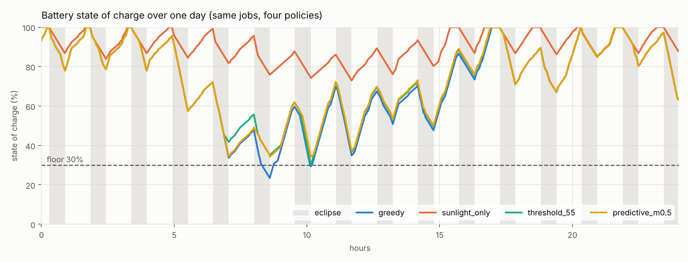

# Orbital Power Scheduler

A bench-scale model of the problem behind orbital AI compute: running machine-learning
jobs on a satellite's power budget. The Sun pays the bills for 56 minutes of every
92-minute orbit, the Earth's shadow takes 36 minutes of that away, the battery is small,
and the AI jobs arrive whenever they want. The scheduler decides when each job runs so
that important work finishes and the battery never dies.

Started October 2026 by Donovan Edwards, Virginia Tech Electrical Engineering.



## Quick start

```bash
pip install -r requirements.txt
python -m tools.budget            # 1. first-principles check: does the energy budget close?
python -m sim.run_sim             # 2. one week, 4 policies, 20 random seeds
python -m sim.experiments         # 3. all experiments (about 3 minutes)
python -m sim.optimal_baseline    # 4. compare against the provably best schedule
python -m pytest -q               # tests pinned to hand calculations
```

Run everything from the repo root.

## Read the code in this order

Each file depends on the one before it.

| File | What it is | Read it for |
|---|---|---|
| `src/orbit_power.py` | the physics | orbit period from Kepler's law, eclipse length from beta angle, panel output, a battery with losses and a charge limit, the per-orbit energy budget |
| `src/workload_profile.py` | the jobs | power, runtime, priority, deadline, value; energy = power × time |
| `src/scheduler.py` | the decisions | job arrivals, the minute-by-minute simulator, four policies, battery wear |
| `sim/run_sim.py` | the scoreboard | multi-seed comparison, the one-day plot |
| `sim/experiments.py` | the lessons | the six experiments below |
| `sim/optimal_baseline.py` | the reference | a mixed-integer program that finds the best possible schedule |
| `measure/` | Phase 2 | `sensor_check.py` (is the INA alive?), `bench_infer.py` (a repeatable job), `measure_energy.py` (joules per inference). Setup guide: `docs/HARDWARE_SETUP.md` |

## The model in plain English

**Energy in.** A satellite at 400 km goes around in 92.6 minutes (Kepler: $T = 2\pi\sqrt{a^3/\mu}$).
At beta angle 0 it spends 36.1 minutes in shadow. A 9 W sun-tracking array therefore earns
$9 \times 56.5/60 \approx 8.5$ Wh per orbit. A body-fixed panel earns only about half that,
because the Sun hits it at an angle most of the time.

**Energy out.** The spacecraft bus (radios, attitude control, heaters, flight computer) burns
2.5 W no matter what: 3.86 Wh per orbit. Compute is whatever the scheduler starts.

**The battery** is 12 Wh with a planning floor at 30 % charge. Charging and discharging each lose
5 % (90 % round trip), charging is capped at 6 W, and sunlight that arrives when the battery is
full is dumped.

**Protection.** Like a real power system, the simulator pauses compute (load shedding) if running
it would push the battery below its floor. Policies can't turn this off, so "never breaks the
floor" is not a policy's achievement; *not needing* to be paused is.

**The four policies.**

| Policy | Rule |
|---|---|
| greedy | Start the most important job as soon as the processor is free |
| sunlight_only | Compute only while the array produces |
| threshold_55 | Priority-1 jobs anytime; others in sunlight, or in eclipse if charge ≥ 55 % |
| predictive | Project the battery one orbit ahead; start a job only if the projection never drops below floor + margin |

All policies share the same job streams, preemption rule (a more important job pauses a less
important one), and deadline handling (a job that can no longer finish in time is dropped).

## Results so far (synthetic workload, 20 seeds)

**Baseline** (9 W tracking array, 0.08 jobs/min, budget margin about +0.65 Wh per orbit):

| policy | missed jobs | priority-1 missed | value done | min charge | load-shed minutes |
|---|---|---|---|---|---|
| greedy | 15.7 ± 8.6 | 14.2 | 97.1 % | 21 % | 591 |
| sunlight_only | 102.7 ± 6.1 | 100.3 | 80.0 % | 50 % | 0 |
| threshold_55 | 3.6 ± 3.2 | 2.1 | 99.5 % | 24 % | 32 |
| predictive (0.5 Wh) | 1.8 ± 2.4 | 0.0 | 99.9 % | 33 % | 0 |

With plenty of energy, greedy, threshold, and predictive look almost the same. The interesting
results show up when the budget gets tight:

| Experiment | greedy | threshold_55 | predictive | What it teaches |
|---|---|---|---|---|
| Shrink array to 7 W | 63.0 % | 64.0 % | 98.1 % | When energy is scarce, *which* jobs get the energy matters more than when they run |
| Heavy batch workload | 76.8 % | 86.5 % | 95.1 % | The processor becomes a bottleneck too; no policy completes everything |
| Floor raised to 60 % | 93.8 % | 93.8 % | 99.9 % | Above 55 %, the threshold rule turns into greedy |
| Body-fixed 9 W panel | 16.7 % | 16.8 % | 59.8 % | The budget barely closes; panel geometry decides everything |

(Value of work completed, mean of 20 one-week runs. Full tables in `results/experiments.md`.)

**Against the best possible schedule** (`results/optimal_baseline.md`): on 10 stressed 4-orbit
windows (7 W array, starting at 45 % charge), predictive reaches 98.5 % of the optimum on average,
threshold 77.4 %, greedy 74.6 %, sunlight-only 67.6 %. The optimum is clairvoyant and fully
preemptive, so it is an upper bound no real policy can exceed.

**Seasons** (`results/beta_sweep.png`): eclipse shrinks from 36.1 minutes at beta 0° to zero above
about 70°. A sun-tracking array gets easier as beta rises. A body-fixed panel gets *harder*, because
the Sun slides off its face faster than the eclipse shrinks.

**The 55 % threshold** (`results/threshold_sweep.png`): sweeping it from 35 % to 85 % barely changes
anything (75–77 % value on a 7.5 W array). The threshold only controls eclipse decisions, but the
damage is done in sunlight: batch jobs running in sunlight eat the charge the next eclipse needs.
In one week (seed 0), threshold_55 enters eclipse at 41 % charge on average and misses 121
priority-1 jobs; predictive enters at 55 % and misses none. It sees the eclipse coming because it
looks across the whole orbit.

## Honest limitations

* **The workload is synthetic.** Every number in `SYNTHETIC_PROFILES` is a placeholder. Phase 2 replaces them.
* **The value weights (10 / 3 / 1) shape the scores.** Predictive wins partly by skipping low-value batch
  jobs to protect high-value ones. Change the weights and the ranking may change. Report missed jobs as well as value.
* **Battery wear is notional.** The cycle-life curve in `scheduler.py` is a placeholder power law. Use
  your cell's datasheet before quoting battery years.
* **The predictive policy knows the orbit but not future jobs.** That's realistic: orbits are predictable,
  workloads are not.
* **No thermal model.** In vacuum, compute heat has to be radiated away, which limits power just like the battery does.
* **The compute board is assumed power-gated (0 W) when idle.** A real Raspberry Pi idles around 2–3 W,
  which would come out of the bus budget. Phase 2 measures this.

## Roadmap

1. **Phase 1, simulation:** done (this repo).
2. **Phase 2, measurement (next):** Raspberry Pi + INA219/INA260 power monitor. Measure energy per
   inference at full and throttled clock speed, then fill in `MEASURED_PROFILES`.
   Step-by-step: [`docs/HARDWARE_SETUP.md`](docs/HARDWARE_SETUP.md).
3. **Phase 3, hardware in the loop:** the Pi runs real jobs while a simulated orbit clock (60× speed)
   and simulated battery decide when they may start. Film the eclipse backlog forming and draining.
4. **Phase 4, the story:** plots, a results write-up, a two-minute demo video.

Next simulation upgrades worth trying: let the scheduler pick clock speed per job (DVFS), add a
thermal limit, and use the "wasted solar" metric to start batch work when the battery is full.

## Check yourself

1. Why can no scheduler fix a budget that's negative over a full orbit?
2. Your array gets 20 % bigger. Which improves first, deadlines or depth of discharge? Test it.
3. A model is twice as fast at three times the power. Better or worse here? Show the energy math.
4. Why does sunlight_only miss priority-1 jobs, even though it never stresses the battery?
5. In the threshold sweep, why does changing the threshold barely matter?
6. Predictive uses 0.5 Wh of margin. Defend that number using `results/threshold_sweep.png`.

## Phase 2 parts

Raspberry Pi 4 or 5, an INA260 or INA219 breakout, a way to put it in series with the Pi's 5 V supply,
jumper wires. Details in [`docs/HARDWARE_SETUP.md`](docs/HARDWARE_SETUP.md).
